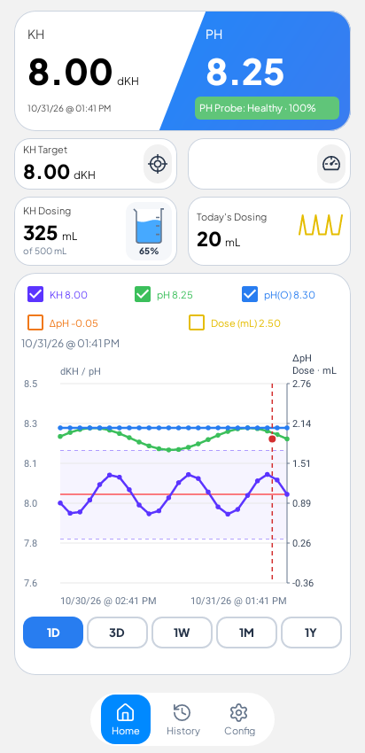
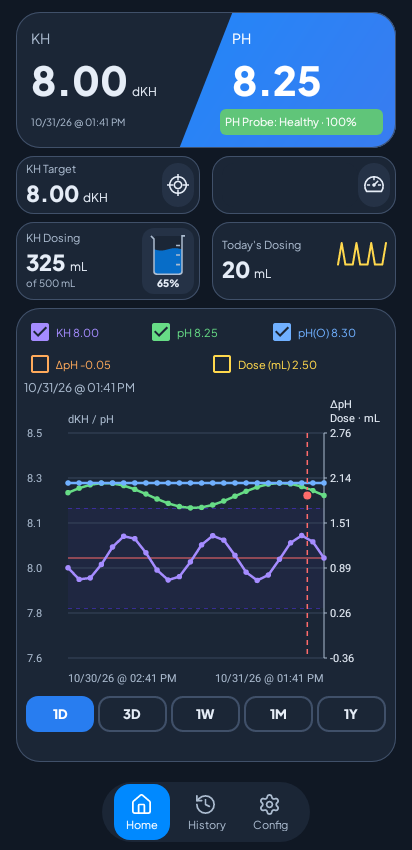
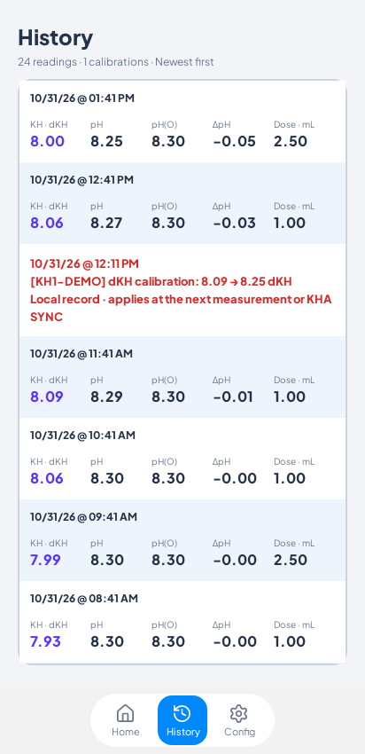
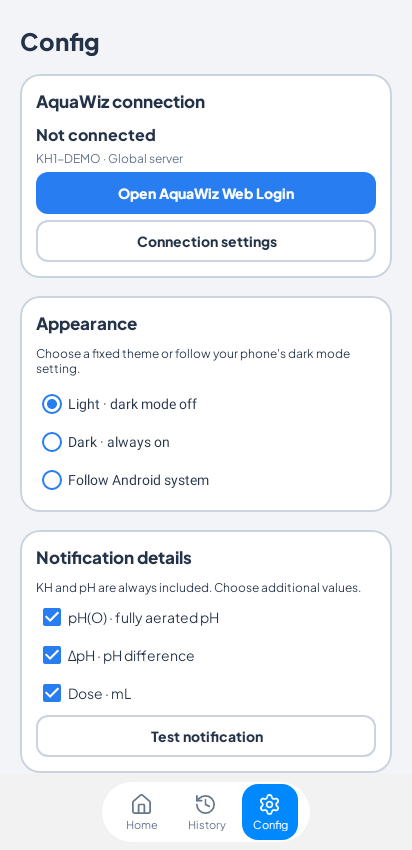

## Local dKH calibration history

- Successful calibration requests now appear in History and the Status activity log, showing the time, previous reading when available, and entered dKH.
- The chart marks each adjustment with a dashed red vertical line and a red point at the entered level. Tap the marker to inspect it.
- Calibration records stay on your phone, survive app restarts and refreshes, and are included in support exports. They do not alter server measurements or dosing totals.
- Entering 0 records that calibration was disabled without drawing a zero-dKH point.

The marker shows when AquaWiz accepted the request. The controller applies the setting at its next measurement or KHA SYNC.

## Updated screenshots

Current app views rendered with sample controller data. Light and dark Home show the calibration marker; History shows the separate local event. Config includes Light, Dark, and Follow Android system.

| Home · light | Home · dark |
| --- | --- |
|  |  |

| History | Config |
| --- | --- |
|  |  |

## Install

Download **AquaWizNotifier.apk** below and install over your existing signed app to retain local history and preferences. This is the public release following v0.8.22-preview, signed with the existing release key.
