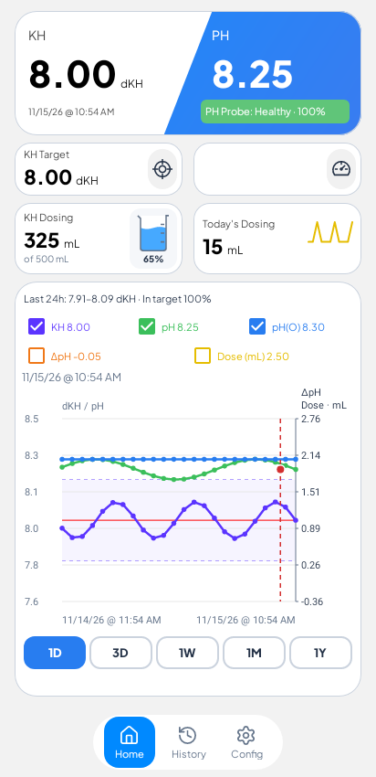
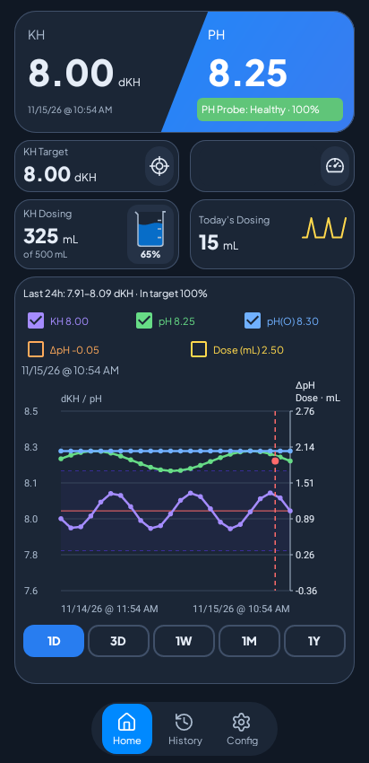

## Compact 24-hour KH summary

A single line above the chart shows the saved KH range and percentage of readings within the controller’s current target bounds:

**Last 24h: 8.22–8.72 dKH · In target 100%**

- Always uses a rolling 24-hour window, independently of the selected chart range.
- Uses locally retained raw readings, without additional server requests. The percentage counts readings within the current target bounds.
- Shows unavailable values when readings or target bounds are missing.
- Supports light/dark mode and allows larger accessibility text to wrap.
- Today’s dosing remains in the hero area.

## Screenshots

Current app views rendered with sample data.

| Light | Dark |
| --- | --- |
|  |  |

## Install

Download **AquaWizNotifier.apk** and install over your current signed app. This update uses the existing signing key and preserves local history and preferences.
